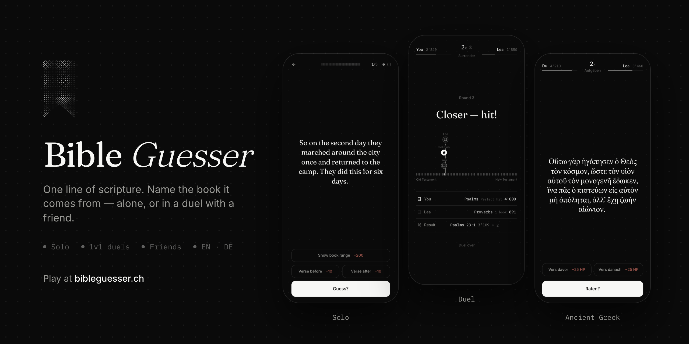

### Hi, I'm Jannik 👋

I'm building **[Bible Guesser](https://bibleguesser.ch)**, a guessing game for the Bible. You get one verse and name the book it comes from. The closer your guess, the more points you score.

- **Solo:** five rounds, with hints if you need them
- **Duels:** play a friend live. The closer guess wins the round, and the gap becomes damage.
- **Your translation:** NIV, Schlachter, Hoffnung für alle or Ancient Greek, in English or German
- **Friends:** send requests, see who's online and climb the scoreboard

**Play it at [bibleguesser.ch](https://bibleguesser.ch)**, on your phone or on the web.

Built with Next.js, Supabase and Tailwind.
